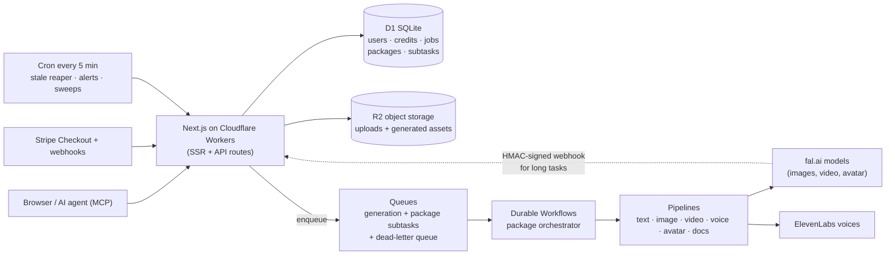

# Klamdo — a live AI content SaaS with paying subscribers

> **[klamdo.app](https://klamdo.app)** — an AI content platform for coaches and founder-creators:
> identity-consistent images and short vertical videos from your own photos, plus agentic
> "content packages" that turn one brief into a full campaign (scripts, images, video,
> voice-over, talking-head avatar, slide deck, e-book). Built, deployed and operated solo on
> Cloudflare's serverless edge. **Live with Stripe billing and paying subscribers since
> September 2026.**

**Role:** Sole founder, architect and engineer — product, infrastructure, billing, security,
operations and the public MCP integration.
**Status:** In production. Live Stripe subscriptions renewing monthly. Public MCP server
published on npm (`klamdo-mcp`) and as a hosted endpoint, so AI agents can generate content
through it.

---

## 1. Problem

Coaches and founder-creators need a steady stream of content that looks like *them*, but
filming and editing every post doesn't scale, and generic AI image tools produce a random
face. A product that solves this has to deal with hard engineering realities at the same
time:

- **Generation is slow and unreliable.** A single video can take minutes; providers time
  out, rate-limit and occasionally return empty or truncated files.
- **Users pay per result.** Credits must be reserved up front, refunded automatically when a
  step fails, and never double-charged on retry.
- **One brief fans out into many dependent steps.** A campaign package needs a script before
  the voice-over, the voice-over before the avatar video, images before the video clips.
- **It has to cost almost nothing when idle** — a solo-founder product cannot pay for an
  always-on cluster.
- **It's a public, paid web app**, so authentication, payment webhooks, abuse limits,
  privacy law (GDPR/CCPA) and content policy all have to be real, not stubs.

---

## 2. Architecture

- **Edge-native and pay-per-use:** Next.js App Router compiled for Cloudflare Workers
  (OpenNext), D1 for relational data, R2 for media, Queues and Workflows for background
  work, a scheduled trigger for maintenance. No servers to run; idle cost is near zero.
- **Fast path vs slow path:** the request path validates, reserves credits, writes the job
  row and enqueues — returning in well under a second. All expensive work runs in the
  background, and the client polls job status.
- **Package orchestration:** a package is decomposed into typed subtasks arranged in
  dependency waves (script → voice-over → avatar video; images → clips → concatenation).
  Each subtask is dispatched to its pipeline (text, image, video, audio, avatar, merge,
  documents). Nine package types, from social-media campaigns and UGC ads to
  coaching-brand kits and faceless content.
- **Long tasks via signed webhooks:** multi-minute video/avatar jobs are submitted with a
  signed callback URL and parked as `async:pending`; the callback is HMAC-verified and
  finalizes the subtask in a fresh invocation. Short jobs (images, voice) poll.
- **Agent-ready API:** per-user API keys, a REST API and a Model Context Protocol server in
  three transports (hosted HTTP endpoint, `npx klamdo-mcp` over stdio, self-hosted). Agents
  can list packages, create jobs and fetch a structured *manifest* of the deliverables. My
  own agent platform generates its images and videos through this endpoint.

---

## 3. Billing and credits

- **Stripe Checkout + webhook-driven entitlement:** subscriptions, a free first sample per
  account, a 1-day trial, top-up credit packs, coupons and an affiliate program. Webhook
  events are recorded in a processed-events table so retried deliveries are idempotent.
- **Tiered plans** (Starter → Creator → Pro → Agency) gate which packages a user can run and
  set per-tier hourly/daily rate limits and spend caps.
- **Reserve → consume → refund:** credits are reserved when a job is accepted; every failed
  subtask is refunded at the end of the run and the user is emailed the refunded amount.
- **Lesson baked in:** the cost estimator must mirror the *runtime* expansion of a package
  (one "multi-shot video" step becomes six clips plus a concatenation). An early mismatch
  let consumed credits exceed the reservation; the estimator now models the expansion
  exactly.

---

## 4. Reliability — the self-healing stack

| Failure mode | Defense |
|---|---|
| Provider outage / 5xx storm | Per-provider **circuit breaker** (closed → open → half-open), with state persisted to D1 so every Worker isolate shares it |
| Message processed too many times | **Dead-letter queue** consumer marks the subtask failed cleanly instead of retrying forever |
| Job stuck mid-pipeline | **Stale reaper cron** (every 5 min) with different cut-offs for sync vs webhook-pending work |
| Empty / truncated media from a provider | **Byte-size validation** on every image, video and audio asset before it's saved — fails the step so it retries |
| Bad deploy | Deploy script captures the previous version, runs a **smoke test** against the new one and **auto-rolls back** on failure; an `npm audit` gate blocks high/critical vulnerabilities |
| Silent failure spikes | **Email alerting** on failure-ratio, absolute-failure count and CSP-violation spikes, each with its own cooldown |
| Orphaned storage | Daily **R2 orphan sweep** that only deletes unreferenced blobs older than 14 days and aborts if the reference query fails |
| Dependency drift | Daily health check of third-party voice assets with alerting |

Operations tooling: an admin health dashboard (volume, failure rates by type, p50/p95
durations, provider failures, refunds, partial failures) and a CLI for triage
(`recent`, `failures`, `stuck`, `dlq`, `retry`, `refund`, `tail`).

---

## 5. Security and compliance

- **Nonce-based Content-Security-Policy** generated per request in middleware (no
  `unsafe-inline` scripts), HSTS preload and a full set of hardening headers; a CSP
  violation report sink feeds the alerting above.
- **Auth:** first-party email/password with PBKDF2-SHA256 at the platform's maximum
  iteration count and transparent rehash-on-login; per-IP brute-force lockout; httpOnly,
  SameSite=strict sessions; admin access via a separate cookie-auth'd session.
- **SSRF-hardened asset proxy** and an allow-listed download proxy that sanitizes filenames
  and content types.
- **GDPR/CCPA:** self-serve data export and account deletion (which also cancels the Stripe
  subscription); real Terms, Privacy, DMCA and content policies.

---

## 6. What broke, and what I learned

- **"Accepted" is not "done."** A serverless render integration returned HTTP 202 for every
  request — including for a function that had never been deployed. Async integrations now
  get an independent verification path (status artifacts checked by cron), never trust in
  a 202.
- **Platform limits are real limits.** Raising password hashing to 600k iterations exceeded
  the Workers WebCrypto ceiling and blocked every signup. The fix was the platform maximum
  plus rehash-on-login — and a rule to check runtime limits before "hardening."
- **Serverless runtimes kill unfinished work.** Fire-and-forget emails after a redirect were
  silently dropped until they moved into `ctx.waitUntil()`.
- **Two CSP headers are AND-ed by browsers.** A static policy plus the middleware nonce
  policy blocked the app's own scripts; policies are now route-scoped.
- **Status labels must not lie.** A package reported "completed" while several image steps
  had failed, because the rule was "failed only if *all* steps fail." It's now "failed if
  *any* required step fails," with successful assets still delivered.
- **Garbage in, random faces out.** Placeholder images left in a reference pack made the
  model anchor on grey squares. Placeholder hosts are now rejected at write time and
  filtered at run time, and the UI shows thumbnails of the actual reference photos before
  credits are spent.

---

## 7. Technology

| Area | Used |
|---|---|
| App | Next.js (App Router), React, TypeScript, OpenNext |
| Platform | Cloudflare Workers, D1, R2, Queues (+DLQ), Workflows, Cron Triggers, Turnstile |
| AI | fal.ai (image, video, avatar models), ElevenLabs voices, LLM prompt rewriting and script generation |
| Billing | Stripe Checkout, subscriptions, webhooks, coupons, affiliate payouts |
| Email | Resend (transactional, campaigns, alerts) |
| Agents | Model Context Protocol server (HTTP + stdio), npm package, API keys, package manifests |

## 8. Outcomes

- **A real business, not a demo:** live at klamdo.app with Stripe subscriptions renewing
  monthly since September 2026.
- **Near-zero idle cost** on a fully serverless stack, operated by one person.
- **Failures are contained and refunded**, not silent: circuit breakers, DLQ, reaper,
  validation, alerting and automatic rollback.
- **Usable by AI agents**, not just people: a published MCP server and API that another
  agent platform uses in production.
