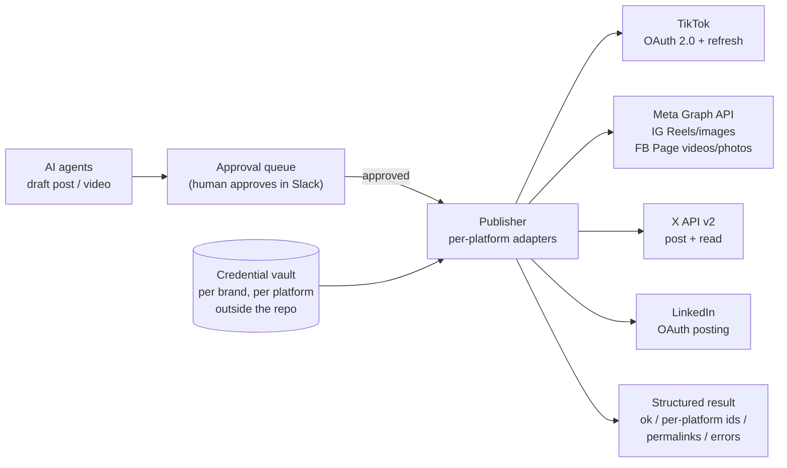

# Multi-Platform Social Publishing — one approval-gated pipeline for TikTok, Instagram, Facebook, X and LinkedIn

> A case study in connecting an AI content system to five social platforms through their
> official APIs, with OAuth and token lifecycle handled once, per-account credential
> isolation, independent per-platform failure handling, and a human approval gate
> in front of every public post.

**Role:** Sole architect and engineer. I designed and built the integrations, the credential
model, and the approval-gated publishing flow.
**Status:** Running in my own automation platform. Instagram/Facebook, X and LinkedIn
publishing are live and have posted real content. The TikTok integration covers OAuth,
token lifecycle and account/video data (discovery); TikTok publishing is the next lane.
All identifiers, endpoints and credentials in this write-up are placeholders.

---

## 1. Problem

I run several branded content accounts across platforms, with AI agents drafting the
posts and videos. Posting by hand did not scale, but "let the AI post" was not acceptable
either. The real requirements were:

- **Every platform authenticates differently.** TikTok uses OAuth 2.0 with short-lived
  access tokens and long-lived refresh tokens. Meta uses business tokens plus a derived
  Page token. X uses OAuth 1.0a user context. LinkedIn uses OAuth 2.0 with a ~60-day token
  and no refresh. Each one fails in its own way when a token expires.
- **Accounts must never cross-post.** Each brand has its own accounts. A post meant for
  one brand appearing on another is a reputational incident, not a bug.
- **Publishing is asynchronous on some platforms.** Instagram Reels are uploaded into a
  *container* that Meta transcodes for seconds to minutes before it can be published.
- **One platform failing must not block the others.** If Facebook rejects a video, the
  Instagram post should still go out, and the failure should be visible.
- **No unapproved public posts.** A human approves every post before anything is
  published.

---

## 2. Architecture

**Flow:** agents only *draft*. The draft lands in an approval queue. Only the human
approval triggers the publisher, which looks up that brand's credentials, calls each
platform adapter independently, and returns one structured result with per-platform IDs,
permalinks and errors.

---

## 3. Key decisions and trade-offs

**Approval gate in front of every public action.** The approval itself triggers the
publish. Agents can draft as much as they like, but no code path lets an agent publish
directly. This trades a little latency for zero unapproved posts.

**Credentials per brand, per platform, outside the codebase.** Each brand has its own
credential block in a vault file outside the repository (for example `meta_<brand>`). A fresh API client is built per call for the requested brand, so mixing
two brands' sessions in one client is structurally impossible. Brands without
credentials are skipped cleanly rather than failing the run.

**Token lifecycle handled in the adapter, not by callers.**
- TikTok: authorization-code exchange, tokens persisted atomically to the vault, and the
  access token refreshed automatically ~5 minutes before expiry. Callers never see a
  token.
- Meta: a Page access token is derived from the business token at publish time, because
  Page video/photo endpoints require it.
- LinkedIn: no refresh grant is available, so the expiry date is tracked and a re-auth is
  scheduled ahead of it.

**Async publishing with explicit polling.** Instagram Reels are created as a container,
then the publisher polls the container status (`FINISHED` / `ERROR` / `EXPIRED`) at a
fixed interval with an upper time bound before calling `media_publish`. A stuck
container fails loudly with its status instead of hanging the worker.

**Independent per-platform execution.** Each platform call is isolated. The result is
`ok` if *any* target succeeded, and every failure is reported with the platform name and
the API's error message, so a partial success is visible, not silent.

**Read-only capability check before go-live.** A dry-run mode verifies that the token
can see the Instagram account, its publishing quota and the Facebook Page, and that a
Page token can be derived, without posting anything. New brands are validated this way
before their first real post.

**Errors as data.** Adapters return structured `{ok, ids, permalinks, errors}` results
instead of raising into the agent loop, so agents and dashboards can reason about what
happened.

---

## 4. Technology

| Area | Used |
|---|---|
| TikTok | Login Kit OAuth 2.0 (v2), token endpoint, user.info, video.list; automatic refresh |
| Meta | Graph API v21: IG content publishing (Reels + images via container → `media_publish`), FB Page videos/photos, content publishing limit |
| X | API v2 via tweepy: create post, read recent posts, per-brand clients |
| LinkedIn | OAuth 2.0 member posting |
| Runtime | Python, `requests`, retries with exponential backoff, structured logging |
| Control plane | Approval queue (human approval in Slack); credentials in an external vault file |

---

## 5. Outcomes

- **One publish call reaches multiple platforms**, with one structured result containing
  each platform's post ID and permalink.
- **Zero cross-brand posts by design:** clients are built per brand per call from
  isolated credentials.
- **Partial failures are visible and non-blocking:** an Instagram failure does not stop
  the Facebook post, and both outcomes are reported.
- **Expired tokens stopped being outages:** refresh is automatic where the platform
  allows it and scheduled re-auth where it does not.

## 6. What I'd build next for a multi-tenant SaaS

The same pattern extends to a product where end users connect their own accounts:

- An OAuth "Connect account" flow per platform (PKCE + state validation), tokens
  encrypted at rest per user.
- A background token-refresh worker plus clear "reconnect required" states in the UI.
- A scheduled-publishing queue (most platform APIs publish immediately, so scheduling
  lives in the product), with per-post status, retries and readable errors.
- Platform-review readiness: for example, TikTok restricts content from unaudited API
  clients to private visibility until the app passes its audit.
